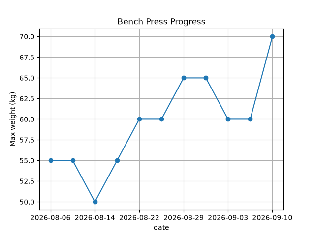

# Workout Log Analyzer

Turns my own messy gym log (CSV) into each exercise's personal best, and tracks how my bench press progressed.

## Key results
- Cleaned real, messy gym data: the gym changed how assisted machines were labeled mid-way
  ("8th from top" → "40"), so I converted old labels to actual weights instead of dropping them.
- Bench press went from 55 kg to 70 kg in 5 weeks, with a plateau in late August before a new PR.
- Rewrote the 40-line plain-Python version in 6 lines of pandas, and verified both give identical results.



## Why I built this
I wanted to see how fast my strength is actually improving, and to spot when I hit a plateau.

## How to run
Put your workout log (CSV) and the script in the same folder, then run:

```bash
python3 load_data.py   # plain Python version
python3 analyze.py     # pandas version
```

## Output
```
Smith machine bench press: 40.0
Dumbbell incline press: 45.0
Dumbbell lateral raise: 20.0
Dips: 40.0
Triceps push down: 40.0
Lat pulldown: 45.0
Barbell row: 20.0
One handed rows: 15.0
Face pull: 25.0
Dumbbell curl: 12.5
Back squat: 60.0
Leg press: 110.0
Bench press: 70.0
Chest press: 60.0
Assisted pull up: 40.0
Chest supported row: 25.0
Overhead press: 35.0
Shoulder press: 20.0
Leg extension: 50.0
Chest fly machine: 90.0
Arm curl: 10.0
Foot-Assisted Chest Press: 20.0
```

**Data note:** all weights include the 20 kg barbell. Early bench press records were logged without the bar, so I corrected them retroactively.

## The hardest part: messy real-world data
The hardest part was deciding how to handle inconsistent records. Partway through, the way dips were logged changed:

```
2026-08-06,Dips,7th from top,10
2026-08-14,Dips,40,10
```

The reason was simple: the gym changed the labels on the assisted machine. But `float()` cannot convert a string like "7th from top" into a number, so it raised a `ValueError`.

I considered three options:
1. Drop dips entirely
2. Drop only the old-format records
3. Convert the old labels into actual weights, since I knew what each label meant

I chose option 3. To do that, I first had to find out exactly which labels existed and replace every one of them. I tried pulling out only the dips rows to check, but I didn't yet know an efficient way to do it, and it got tangled with my existing code, so it took real effort.

Treadmill entries had the same problem. Since I only did cardio occasionally and it is not relevant to strength progress, I excluded those rows using `try/except`.

## Rewriting it with pandas
I rewrote the same logic in pandas (`analyze.py`). The plain-Python version is 40 lines; the pandas version is 6.

| Step | Plain Python | pandas |
|---|---|---|
| Read and split | `open` + `split(",")` | `read_csv()` |
| Values that can't be converted | `try/except` → `None` | `to_numeric(errors="coerce")` → `NaN` |
| Exclude them | `continue` | `dropna(subset=["weight"])` |
| Aggregate | compare max values in a dict | `groupby().max()` |

I verified that both versions produce exactly the same output by comparing their dictionaries.

## Example analysis: bench press progress
In 5 weeks, my best bench press went from 55 kg to 70 kg. There was a plateau in late August before I set a new PR.